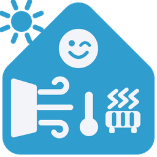

# NaPohodu

Integrace pro Home Assistant, která v každé místnosti udržuje zvolenou
teplotu a kvalitní vzduch. Rozhoduje, kterým prostředkem toho dosáhnout,
a hlídá, aby si topení, větrání a stínění nelezly do cesty.

## Jak je to poskládané

Celý model stojí na dvou pojmech. Pochopit rozdíl mezi nimi je klíč
k tomu, aby nastavení dávalo smysl.

### Místnost

**Místo, kde měříš a kde chceš být spokojený.** Má svoje čidla, topení,
okna, žaluzie a lidi. Rozhoduje se za sebe a ovládá svoje pohony.

Do místnosti svítí slunce, v místnosti se spí, v místnosti je nebo není
někdo doma. Všechno, co se dá ukázat prstem, patří místnosti.

### Oblast

**Místnosti, které spolu dýchají.** Průchozí prostor, otevřené dveře.
Vzduch se v nich míchá, takže nemá smysl počítat CO2 zvlášť — bere se
nejhorší hodnota z celé oblasti a vyvětrat ji může kterékoli okno.

Oblast sama nic neovládá. Nemá okna ani žaluzie, neposílá povely. Jen
říká, co spolu souvisí.

**Místnost, která s ničím nesousedí, oblast nepotřebuje.** Rozhoduje se
sama za sebe a nic jí nechybí.

### Proč zrovna takhle

Rozdělení je jednoduché. **Cokoli, co se ovládá, patří místnosti.
Oblast je jen informace o tom, že vzduch teče i mezi nimi.**

Příklad: kuchyň a obývák jsou průchozí, tvoří oblast. Ložnice za dveřmi
je samostatná. Obě si nastavíš jako sousední, aby se v noci mohly
zastoupit — když se v ložnici spí, vyvětrá ji kuchyňské okno a nefouká
ti na hlavu.

## Co to umí

### Adaptivní cílová teplota

Počítá se z klouzavého průměru venkovní teploty za týden podle
EN 16798-1. V zimě vychází níž, v létě výš, protože se člověk aklimatizuje.
Ovládáš jediný posuvník s odchylkou, zvlášť pro každou místnost.

Průměry si integrace počítá sama exponenciálním průměrem, takže
nepotřebuje statistické senzory ani historii. Vlastní čidlo můžeš zadat
a přebije ten počítaný.

**Čerstvá instalace se neřídí prvním dnem.** Exponenciální průměr se
musí z něčeho nasadit a jediné, co v tu chvíli existuje, je první
změřená hodnota — kdo integraci spustí v babím létě, nesl by si
dvacet stupňů v průměru i do listopadu, protože sedmidenní konstanta
takovou chybu stahuje po týdnech. Cíl by přitom seděl o dva stupně
výš, než má: jeden stupeň v průměru je 0,33 °C na cíli.

Dokud se průměr učí kratší dobu než tři své časové konstanty, platí
proto **obyčejný průměr všeho naměřeného**. Ten první čtení
nepřeceňuje a po dvou dnech už odpovídá počasí. Potom se přechází na
exponenciální, protože ten na rozdíl od obyčejného zapomíná — po
měsíci provozu by průměr „od začátku" mluvil pořád o létě. Přepíná se
až po třech týdnech schválně: po jednom by z chyby prvního čtení
zbývalo 37 % a cíl by v ten den o stupeň poskočil zpátky nahoru.
Měřeno na zapnutí v babím létě a ochlazení druhý den vychází největší
skok cíle 1,1 °C při přepnutí po týdnu, 0,4 °C po dvou a 0,2 °C po
třech, tedy na úrovni zaokrouhlení.

Tlačítko na zahození naučeného průměru tu schválně není. Opravovat
ručně něco, co se za dva dny spraví samo, je nastavení navíc, které
se používá jednou za život a mezitím mate. Když je přesto potřeba
začít znovu — třeba po týdnu, kdy teploměr hlásil nesmysly — stačí
integraci na víc než týden vypnout: delší výpadek se bere jako nový
začátek a průměr se nasadí znovu.

**Zimní přitápění.** Adaptivní norma je psaná na letní komfort
v přirozeně větraných budovách: čím tepleji venku, tím vyšší teplotu
lidé doma snesou. V zimě se proto jen opře o dolní hranici a dál nic.

Přitom v mrazu chladnou stěny a okna, klesá střední radiační teplota
a člověku je při stejném vzduchu chladněji, protože do studených ploch
vyzařuje vlastní teplo. Integrace to dorovnává: pod nastaveným prahem
přičte k cíli podíl toho, o kolik je venku chladněji, a po nastaveném
náběhu se zastaví na plné hodnotě — hlubší mrazy už na tom nic nemění.
Se výchozím prahem 7 °C a plným stupněm od 4,5 °C to odpovídá tomu, co
se v praxi osvědčilo. Je to vědomé doplnění normy, ne její oprava, a dá
se vypnout nulovým prahem.

Z čeho se cíl skládá, je vidět v diagnostice — základ z křivky,
přitápění i společný posun zvlášť.

### Větrání podle vzduchu i teploty

CO2 a prach, obojí s mrtvou zónou, aby okno
neposkakovalo. Jakmile větrání začne, pokračuje až pod dolní práh —
mrtvá zóna brání zahájení, ne dokončení.

Délka větrání se řídí **skutečným ochlazením místnosti**, ne stopkami.
Časovač je jen pojistka. Zadává se rovnou, o kolik stupňů smí teplota
klesnout — zvlášť ve dne a zvlášť v noci, protože v noci se snese víc.

Rosný bod z Magnusova vzorce zkracuje větrání, když hrozí kondenzace.
Teplota se bere tak, jak ji čidlo hlásí — žádné dopočítávání, které by
za rok nikdo nedokázal ověřit.
Prachu se nevěří, když čidlo právě neměří — u čidel s ventilátorem se
zadá jeho spínač.

### Nárazové větrání

Když je venku chladněji než cílová teplota, stojí každé větrání teplo.
V takové chvíli je krátký průvan všemi okny naráz účinnější než dlouhé
větrání jedním oknem — vzduch se vymění rychleji a stěny se nestihnou
vychladit.

Stačí, aby vzduch potřebovala jedna místnost, a otevřou se všechna okna,
kterým v tom nic nebrání. Vítr, déšť, pojistky nebo prázdný byt
zůstávají v platnosti a okno tam prostě zavřené zůstane.

Nárazové větrání smí jít pod běžnou spodní hranici třiceti minut, protože
o krátkost tady jde. Ve výchozím stavu je vypnuté.

### Zastupování mezi oblastmi

Někdy je větrání v jedné oblasti drahé a v sousední ne. Dva různé důvody,
stejný důsledek: když se v místnosti spí, větrání budí; když je pod
cílovou teplotou, stojí teplo a okno kmitá sem a tam.

V obou případech vezme vzduch za ni soused za otevřenými dveřmi. Dostane
její CO2, takže otevře dřív, než by musel kvůli sobě, a ona se sama
otevře až při krizi.

Nefunguje to, když by u souseda větrání stálo totéž — tam by se problém
jen přestěhoval o místnost dál.

### Ruční zásah

Když okno otevřeš nebo zavřeš rukou, integrace to pozná — skutečnost se
rozejde s tím, co naposledy poslala. Rozdělané větrání se tím ruší a
půl hodiny se do okna nemluví. Pak se čeká na nový podnět: vyšší CO2,
jiná teplota, příchod noci.

Smyslem je, aby se automatika s člověkem nepřetahovala. Bez toho by po
uplynutí doby držení stavu poslala povel znovu.

**Vítr a déšť platí dál.** Ochrana bytu stojí nad ručním rozhodnutím
stejně jako nad automatikou.

Totéž u žaluzií. Po každém povelu si integrace zapamatuje, na jaké
poloze skutečně skončily, a porovnává ji se skutečností. Když se
rozejde, stav zapomene a příště ho nastaví znovu.

### Prach a co s ním

Prach je jediná veličina, kterou větrání umí zhoršit. Když je venku hůř
než uvnitř, otevřením se natáhne dovnitř a hodnota roste — takže by se
větralo donekonečna.

Se zadaným venkovním čidlem se porovnávají hodnoty přímo. Bez něj se to
integrace naučí z chování: když prach uvnitř při otevřeném okně stoupá,
tahá se zvenčí, a poznatek pár hodin platí.

Na prach se ostatně větrat nemusí. Čistička ho vyřeší bez tepelné
ztráty a v zimě je to skoro vždycky lepší volba.

### Otevřené okno bez záznamu

Když integrace najde otevřené okno, o kterém nemá záznam — po restartu
nebo když povel přišel na okno, které už otevřené bylo — přijme ho za
vlastní a dopočítá, od čeho měřit účinek a kde zavřít.

Mez poklesu se nasadí jen tehdy, když je teplota nad ní. Jinak by
přijetí okna vedlo rovnou k jeho zavření.

### Ohřev venkovním vzduchem

Zrcadlový obraz chlazení: když je pokoj pod cílem a venku je tepleji,
otevře se a teplo se pustí dovnitř. Dojede se na cíl, stejně jako
u chlazení, a v diagnostice se to tak i jmenuje — ohřev venkovním
vzduchem je něco jiného než „venku je příjemně" a má to být poznat.

V noci se kvůli teplotě otevírá jen pro chlazení. Ohřev čeká do rána,
protože ticho je v noci cennější než pár stupňů.

### Nárazový režim

Jedna hodnota říká, jak daleko smí být venkovní teplota od cílové —
nahoru nebo dolů — než se přepne na nárazové větrání. Ve výchozím
stavu patnáct stupňů, takže při cíli 22 °C jde o venkovní teplotu pod
7 °C nebo nad 37 °C.

Rozhoduje **místnost, pro kterou je větrání nejdražší**: pokoj, který
chce 22 a má venku 3, platí za otevřené okno plnou cenu bez ohledu na
to, že dílna vedle chce jen 18 a je jí to skoro jedno. V zimě tedy
rozhoduje nejvyšší cíl, v létě nejnižší. V sekci *Nastavení pro celý
byt* je vidět i skutečný rozdíl a jméno té místnosti, takže se nedá
splést, proti čemu se práh poměřuje.

Za tím prahem se **neotvírá kvůli příjemnému počasí**, protože venku
žádné není. Větrá se jen z důvodu — kvůli CO2, prachu nebo teplotě — a
**zavře se hned, jakmile důvod pomine**, místo aby se čekalo na dojetí
celého cyklu — a to včetně nejkratší doby držení polohy, kterou nárazové
zavření obchází. Délka pulzu zůstává stejná jako jindy; mění se jen to,
že může skončit dřív.

Zavření hned platí **na každý důvod**, ne jen na vzduch — včetně
marného větrání, pojistek a prachu taženého zvenčí. Nárazové
větrání spouští jen CO2 a prach, protože jde o výměnu vzduchu; chlazení
a ohřev ho nezapnou. Jakmile ale jejich důvod doběhne na druhou stranu
— pokoj je na cíli, nebo venku přestalo pomáhat — je v tomhle počasí
každá minuta navíc stejně drahá, ať se větralo kvůli čemukoli. Proto se
i teplotní větrání zavírá okamžitě, kdykoli je nárazový režim možný.

To, že jde o nárazový pulz, si pamatuje **samo větrání**, ne až okamžik
zavírání. Příznak zvenčí totiž platí, dokud je CO2 nad prahem otevření,
kdežto zavírá se až pod prahem zavření — kdyby se nárazové zavření
ptalo jeho, nestihlo by se nikdy.

Platí to **i pro noční větrání**, které má vlastní prahy a vlastní,
čtyřhodinový strop: i to si příznak nese a zavře, jakmile je
vyvětráno. Jinak by okno v mrazu viselo otevřené do rána, protože
nárazový režim mezitím skončil s čistým vzduchem a zavírání by se
vrátilo pod nejkratší dobu držení polohy.

Zatímco nárazové větrání běží, vidí **každá místnost nejhorší CO2
z celého bytu**. Proto se otevře i tam, kde je vzduch v pořádku: o ten
průvan jde. Běh má vlastní hysterezi — spustí ho zóna nad svým prahem
otevření a skončí, až je **každá** zóna pod svým prahem zavření. Bez
toho se sdílení přerušilo už v pásmu mezi prahy, pomocné místnosti
spadly na své vlastní čisté CO2, zavřely jako vyvětrané a iniciátor
dojížděl sám. Pomocná místnost pořád smí zavřít dřív sama za sebe,
když narazí na pojistku „nevychladit pod" — mrazit ložnici kvůli
kuchyni nemá cenu.

Spouští ho **vzduch: CO2 i prach**. Obojí se během nárazového větrání
sdílí po bytě a obojí ho drží, dokud není čistý — v mrazu je krátké
vyvětrání průvanem lepší než půlhodina jedním oknem, a to platí na
prach stejně jako na vydýchaný vzduch. Okruh, kam dosáhne aerosol
z ultrazvukového zvlhčovače, se do prachu nepočítá: čidlo vidí
rozprášené minerály jako prach a vyvětrat se nedají. Bez běžícího
ventilátoru je měření prachu nejisté, takže platí vyšší práh, stejně
jako v rozhodování jedné místnosti. A protože při nárazovém větrání
vidí místnost prach z celého bytu, přestává se z něj učit, jestli si
prach netahá vlastním oknem — z cizí hodnoty se o svém okně nedá
odvodit nic.

**Teplota ho nespouští** a nesdílí se vůbec: chlazení a ohřev mají
vlastní pásmo s dojezdem a každá místnost si je řeší sama. Teplo se
průvanem nepřenáší, takže otevřít ložnici kvůli horku v kuchyni by
ložnici jen vychladilo.

Režim se přepíná s půlstupňovou hysterezí, aby neposkakoval, když se
venkovní teplota motá kolem prahu. Brzda proti otvírání pro pohodu
platí i tehdy, když je nárazové větrání vypnuté — jinak by v mrazu
zůstalo okno otevřené, kdykoli zrovna nic jiného nevadí.

### Kdy venkovní vzduch pomůže

Chlazení i ohřev větráním se spustí, až je pokoj mimo hysterezní pásmo
kolem cíle, a běží k opačné hraně. Samotné překročení hrany ale nestačí
— venkovní vzduch musí mít čím pomoct:

- chladit se dá, jen když je venku **za dolní hranou pásma o nastavenou
  rezervu**, tedy o kus dál, než kam chlazení dojede, a zároveň nad
  spodní hranicí pro chlazení. Bez té rezervy se cyklus doplazí k hraně
  a nikdy ji nepřejde, ve výchozím stavu sedmi
  stupni — dolní hrana pásma by pokoj zastavila sama, jenže zavření
  není okamžité kvůli nejkratší době držení polohy a chlazení se řídí
  nejteplejším čidlem, takže u okna je mezitím výrazně chladněji,
- ohřívat se dá zrcadlově: venku musí být o tutéž rezervu **nad horní
  hranou pásma** a nikde v pokoji se zrovna nesmí přehřívat.

Vzduch, který nedosáhne až k hraně pásma, pokoj tam nedostane, jen ho zastaví
o kus dál — proto se kvůli němu neotvírá vůbec. Cílová teplota se
přitom sama posouvá se sezónou, takže v létě tím chlazení blokované
není. Kvůli CO2 se větrá dál bez ohledu na teplotu.

Když se během větrání dostane teplota do pásma, ale cíl ještě není
dosažený, větrá se dál — s tím, že **kontrola účinku** po nastavené
době ověří, že se teplota opravdu hýbe správným směrem, a jinak zavře.

Když venkovní vzduch přestane pomáhat, protože se venku oteplilo při
chlazení nebo ochladilo při ohřevu, okno se zavře s odpovídajícím
důvodem. A když je pokoj mimo pásmo, ale otevřít nejde, je v kartě
napsáno proč — třeba „venku 12,0 °C, pro chlazení chceme aspoň
12,0 °C".

### Kontrola účinku větrání

Marně otevřené okno v zimě stojí teplo a nic za to nevrací. Jakmile
uplyne nejkratší doba držení polohy, se proto ověří, že větrání vůbec
zabírá: když se CO2 nesnížilo aspoň o padesát ppm ani teplota
nepřiblížila k cíli o tři desetiny, okno se zavře a chvíli se to
nezkouší. Pauza se s každým dalším marným pokusem zdvojnásobí.

Pokrok se měří k tomu, **kam větrání míří** — chlazení dojíždí na
dolní hranu pásma, ohřev na horní, ne na cíl. Jinak by úspěšné
chlazení vypadalo jako zhoršení přesně ve chvíli, kdy pokoj cíl přešel
a mířil na hranu pásma.

Počítadlo marných pokusů se zvyšuje **až když zavírací povel opravdu
projde**, ne už ve chvíli, kdy se marnost pozná: zavření čeká na
nejkratší dobu držení polohy a za tu dobu by se marnost napočítala
tolikrát, kolik minut se čekalo.

Účinek se posuzuje **po úsecích, ne proti okamžiku otevření**. První
úsek trvá nejkratší dobu držení polohy, další třetinu z ní, nejméně
dvacet minut — a nikdy ne víc než ta doba sama, aby kratší nastavení
sledování nezpomalilo. Pod dvacet minut nemá smysl chodit: za kratší
dobu se CO2 ani teplota nestihnou posunout tak, aby se dalo poznat,
jestli se něco hýbe, nebo jen šumí čidlo. Bez úseků by větrání, které
zabralo na začátku a pak se zastavilo, prošlo navždycky — stačilo mu
být lepší než před hodinou.

**Zastavení a zhoršení nejsou totéž.** Po prvním úseku bez zlepšení se
dává ještě jedna šance, protože se větrání může rozjet pomalu; zavírá
se až po druhém v řadě. Zhoršení se řeší hned, jak se pozná.

Nejkratší doba držení polohy platí v obou případech — je od toho, aby
okno nelítalo, a obcházet ji by znamenalo ji zrušit.

Po marném pokusu se nečeká na hodiny, ale **na změnu venkovních
podmínek**, a platí to na všechno větrání — i to kvůli CO2, protože
jinak by se za dvacet minut zkusilo totéž, co minule nezabralo — čas je jen zástupná veličina, skutečný důvod, proč to
nešlo, byl venku. Další pokus se povolí, až se venkovní teplota posune
o nastavený počet stupňů, a to jen tím směrem, který by pomohl —
u chlazení chladněji, u ohřevu tepleji. Měří se od teploty při
posledním marném pokusu, ne od prvního. Když se venku nic nehne,
zkusí se to tak jako tak po nastavené době, ve výchozím stavu po hodině
— ta doba je strop, ne zdržení.

**Čekání ale skončí samo, jakmile zmizí důvod, kvůli kterému se
větralo.** Marný pokus zapsaný nad pokojem, který už nic nechce, by
sliboval pokus, ke kterému nedojde, blokoval by i novou potřebu
a držel žebřík pauz nahoře.

„Zmizel" znamená **návrat na cíl**, ne jen pod práh otevření.
U teploty tedy pokoj na cílové teplotě, u vzduchu CO2 pod prahem
zavření. Práh otevření je totiž tentýž, kterým se větrání spouští —
kdyby se zapomínalo pod ním, bylo by jedno přesný opak druhého
a čekání by nemělo kdy platit: pokoj o desetinu klesne, paměť se
smaže, pokoj se ohřeje zpátky a otevře se znovu, přestože se venku
nic nezměnilo. Cíl je mezi tím: víc než schovat se pod práh, míň než
dojet až na hranu zavření.

Ptá se to na ten konkrétní důvod, ne na to, jestli by se teď otevřelo.
Venkovní vzduch, který zrovna nestačí, je překážka dočasná, ne zmizelý
důvod — na jeho změnu se čeká dál. A větrání **pro pohodu** je výjimka:
žádný důvod nemá, takže by nebylo co zmizet. Kontrola účinku ho dřív
nebo později zavře jako marné, protože nic nezlepšuje; bez téhle
výjimky by se okno v příjemném dni otevíralo a zavíralo pořád dokola.
O poskakování se tak stará tatáž hystereze jako jinde.

Slunce do toho záměrně nevstupuje: čidlo nemá každý a při proměnlivé
oblačnosti by to spíš mátlo.

V hlášce je rozlišené, jestli se nic nehýbalo, nebo jestli se to
zhoršovalo.

Nouzové větrání a ruční žádost o vyvětrání tím neprochází. V kartě je
řádek, který ukazuje, od jakých hodnot se otevřelo a jak dlouho už je
otevřeno; pozorování začíná každým otevřením a zavřením končí.

### Formulář a dashboard

Tatáž hodnota jde měnit v nastavení integrace i šoupátkem na
dashboardu. Platí jednoduché pravidlo: **šoupátko se používá na ladění,
formulář vyhraje jen tehdy, když ho člověk opravdu přepsal.** Klíč,
který integrace vidí poprvé — třeba po přidání nového posuvníku — se
jen zapamatuje a nastavenou hodnotu nepřepíše.

Totéž platí pro zaškrtávátka, která mají protějšek ve formuláři.

Prahy vzduchu se po oblasti berou nejcitlivější, ale **mluví do nich
jen ty místnosti, které tu veličinu samy měří** nebo kvůli ní otevírají
okno. Místnost bez čidla svůj práh v kartě nevidí — negeneruje se jí,
protože v ní sama nic neovlivní — a nemá tedy ani tudy přetlačovat
nastavení těch, které čidlo mají. Když nemá čidlo nikdo v oblasti,
platí všichni.

Generovaná karta ukazuje **jen to, co místnost opravdu má**. Místnost
bez ovládaného okna tedy nemá řádek o rozhodnutí, o posledním povelu,
o tom, co změnu spustí, ani diagnostiku větrání — a nemá ani přepínač
ovládání oken a tlačítko na jejich srovnání. Dřív tam ty řádky byly
a každý jinými slovy psal totéž, že se tu okno neovládá.

Žádat o vyvětrání má ale smysl jen tam, kde je koho: místnost, která
je v oblasti sama nebo s ní nikdo okno neovládá, žádnou žádost
nezakládá.

Jedna výjimka ale platí obráceně: místnost **bez okna v zóně, kde
nějaké okno je**, si o vyvětrání řekne sousedovi, a hranici, od jaké
odchylky od cíle, si určuje svým vlastním číslem. Šoupátka *otevřít
při odchylce od cíle* proto na kartě má, ve dne i v noci, přestože
vlastní okno neovládá.

Zavírací hrana jí naopak nepatří: **cizí žádost dojede na cíl, ne za
něj.** Hlavice v té místnosti míří na cíl, takže přetah za něj by
znamenal topit proti otevřenému oknu vedle. Šoupátko *zavřít až za
cílem* by tedy nic nedělalo a negeneruje se — a protože se tohle
nenastavuje, stojí to v kartě té místnosti mezi pravidly, která
nejdou nastavit. Nenastavitelné chování, které není nikde vidět, se
zapomene a hledá se znovu.

### Teplotní pásmo a pojistky

Teplotní větrání stojí na jedné myšlence se dvěma časy. Kolem cílové
teploty je **hysterezní pásmo**, zvlášť pro den a pro noc, a nad ním
dvě **absolutní pojistky**:

```
cíl                      adaptivní, podle sezóny

denní pásmo              otevřít při odchylce o   2,5 °C
                         zavřít až za cílem o     1,0 °C
noční pásmo              otevřít při odchylce o   2,5 °C
                         zavřít až za cílem o     1,0 °C

pojistky                 nevychladit pod   18 °C
                         nepřehřát nad     27 °C
```

Obě hodnoty pásma platí souměrně: nad horní hranou se chladí venkovním
vzduchem, pod dolní se jím ohřívá, a dojede se na **protější stranu**
cíle, ne na cíl — jinak by se teplota hned začala vracet. Pásmo může
být nesouměrné a zavírací hodnota smí být nula, pak se dojede přesně
na cíl.

**Pojistky zavřou okno bez ohledu na to, proč je otevřené**, a nic
neotevřou. Platí jen proti vzduchu, který tlačí špatným směrem — okno,
které zrovna chladí přehřátý pokoj, pojistka nezavře. Obchází je jen
ruční žádost o vyvětrání.

Větrání kvůli CO2 nebo prachu **čeká na vyvětrání** a o prochladnutí se
stará pojistka. Zavřít na dolní hraně pásma i s dusnem by znamenalo
otevřít hned znovu.

Pásmo a pojistky jsou na to celé dvě čísla pro den a dvě pro noc:
jedna hodnota pro jednu věc, místo několika, které by si na různých
místech dělaly totéž a tvrdily o sobě rozporné věci.

### Otevírání pro pohodu

Kromě větrání z důvodu umí okno zůstat otevřené i tehdy, když nic
nevadí a venku je příjemně. Platí k tomu dvě podmínky: pokoj je uvnitř
pásma a **venkovní teplota je taky v pásmu kolem cíle**. Jinak by se
otevíralo i při devětadvaceti venku, jen proto, že v pokoji je zrovna
dobře.

Konec chlazení nebo ohřevu se pojmenuje podle toho, **co se stalo**:
pokoj na cíli znamená, že se dojelo („vychlazeno na 20,2 °C, cíl
22 °C"), kdežto „venku už nechladí" je důvod, proč se nedá
pokračovat. Hlásit obojí tím druhým znamenalo, že po povedeném
vychlazení přišla stížnost, že to nejde vyhřát — pokoj byl po dojezdu
pod cílem, a tak se zavření vysvětlilo větví pro ohřev.

Okno otevřené pro pohodu se zavírá, až je **vzduch opravdu čistý** —
pod prahem zavření, ne už pod prahem otevření. Mezi těmi dvěma se
pořád větrá, takže okno, do kterého mezitím přišel důvod kvůli CO2, by
se jinak zavřelo o sto ppm dřív, než je vyvětráno; při nárazovém
větrání by navíc uťalo pulz, který běží za celý byt.

Zaškrtávátkem **Otevírat i pro pohodu** se to dá u místnosti vypnout
úplně; pak se okno hýbe jen kvůli CO2, prachu, chlazení nebo ohřevu.

### Noční režim

Jedno dlouhé provětrání místo několika krátkých. Vyšší práh CO2, aby to
nebudilo, a nouzové provětrání nad krizovou mezí. Ráno se od zvolené
hodiny už neotevírá, ale rozjeté větrání se nechá doběhnout.

Zavírá se ze dvou důvodů: když teplota klesne na nastavenou mez, nebo
když je vyvětráno. To druhé se dá vypnout, a pak noční větrání ložnici
zároveň vychladí — při mírném počasí ale může zůstat otevřeno do rána.

V noci platí vlastní pásmo kolem cíle, obvykle širší než denní, aby
okno nejezdilo. Teplotu nad ním drží tytéž dvě pojistky jako ve dne —
jedna hodnota místo bývalé noční meze, tloušťky noční smyčky a pojistky
ve spánku.

Když má oblast souseda za otevřenými dveřmi, vyvětrá ji raději on.

### Topení

**V noci posun cílové teploty** se zadává se znaménkem: záporné číslo
znamená topit míň, kladné víc, nula nechává cíl být.

Cíl se hlavici posílá jen při skutečné změně a **porovnává se s tím, co
hlavice hlásí**, ne s tím, co jsme naposled poslali. Better Thermostat
si cíl občas přepíše sám, takže „už na tom stojí" podle naší paměti
nic neznamená — rozhoduje, co hlásí.

V kartě je proto rozlišené, jestli hlavice opravdu stojí na našem cíli,
nebo jestli hlásí něco jiného a čeká se na klid mezi povely.

### Stínění

Sluneční zisk se počítá pro každé okno zvlášť z jeho azimutu a polohy
slunce, korigovaný naměřeným zářením. Stíní se jen tam, kam svítí.

Žaluzie se ovládají **pojmenovanými stavy**. Pohony, které neumí naklápět
lamely přímo, se řídí posloupností kroků — najeď na procenta, počkej,
zastav za jízdy. Posloupnosti se ladí testerem přímo v nastavení a
ukládají pod jménem, kterých může být kolik chceš.

U každé místnosti se nastaví, **kdy vůbec smí automatika sahat**: vždy,
jen když nikdo není doma, nebo nikdy. A zvlášť zatahování po setmění kvůli
soukromí, buď hned nebo až když někdo do místnosti přijde.

Každá žaluzie má v Home Assistantu entitu **výběru stavu**, kterou ji
pošleš do kteréhokoli jejího uloženého stavu — z karty, automatizace
nebo hlasem. A pro každou přiřazenou roli vznikne tlačítko.

Do výchozího stavu se žaluzie sama od sebe nevrací. V nastavení se
vybere, při kterých událostech k tomu má dojít — konec klidu, rozednění,
odchod nebo příchod. Bez toho zůstane tam, kam ji naposledy poslalo
slunce, soukromí nebo ruka.

**Ruční přestavení se pozná** a automatika pak **nechá žaluzie být** po
dobu, která se nastaví u místnosti (šoupátko *Po ručním přestavení
žaluzií nechat být*, výchozí dvě hodiny). Je to obdoba ručního klidu
u okna, jen s vlastním číslem: polohu žaluzií si člověk vybírá vědomě,
tak bývá ta doba delší. Nula znamená, že automatika pokračuje hned.

Pozná se to tak, že se skutečná poloha rozejde s tou, kterou jsme
poslali — a hlídají se **obě osy**, výška i naklopení lamel. U lamelové
žaluzie se výška celý den nemění a celý rozdíl mezi „zastínit"
a „odstínit" je v naklopení; kdyby se porovnávala jen výška, ruční
naklopení lamel by nebylo vidět vůbec. Co pohon nehlásí, to se nehlídá,
takže u pohonů bez naklápění rozhoduje dál jen poloha.

Tři pojistky brání falešnému poplachu: za jízdy se nekontroluje vůbec,
chvíli po povelu taky ne, protože pohon dojíždí a hlásí polohu se
zpožděním, a rozejití se musí potvrdit dvakrát za sebou — jednorázový
přeskok je skoro vždycky dojezd, ne ruka. Naklopení se přitom posuzuje
hruběji než výška, protože ho pohony hlásí ve velkých krocích.

Dokud se rozejití potvrzuje, **povel na tu žaluzii nejde**. Jinak by se
do té jedné minuty vešel povel na jinou roli, ruční zásah by se vrátil
zpátky a smazal by se tím i důkaz: poloha by zase souhlasila a klid by
se nerozběhl. V kartě je ta chvíle vidět jako *ověřuji rozejití*.

Stisk tlačítka role se bere stejně jako ruka na ovladači — klid se
rozbíhá i po něm, protože i to je vědomá volba.

Klid přežije restart, protože restart není důvod sahat do polohy, kterou
si někdo nastavil pět minut předtím. Obejde ho jen tlačítko **Srovnat
žaluzie**, protože to je výslovný pokyn, a reset vnitřních stavů.

### Sdílená klimatizace

Vnitřní jednotka v jedné místnosti patří té místnosti a řídí se sama.
Jednotka, která obsluhuje celý byt, je jiný případ — musí se rozhodnout,
komu vyhoví. Pro ni se zakládá **sdílená klimatizace** jako třetí typ
vedle místnosti a oblasti.

Cíl se počítá ve stupnici místnosti, kde jednotka fyzicky stojí, protože
tu měří nejlíp. Podle toho, o kolik jsou ostatní počítané místnosti nad
cílem, se dotlačí dolů — nejvýš o dva stupně, aby místnost s jednotkou
nezmrzla. Prázdné a nepočítané místnosti cíl netahají, takže dílna
nechladí celý byt.

**Otevřené okno jednotku nevypne, když je venku tepleji než cíl.** Okno
je tehdy otevřené kvůli vzduchu a tahá dovnitř teplo, takže chladit je
potřeba právě teď. Vypne se jen tehdy, když okno chladí zadarmo.

Při nepřítomnosti se cíl drží dál a na útlum se přejde až při dlouhé
nepřítomnosti, buď přepínačem, nebo automaticky po zvolené době.
U klimatizace to na rozdíl od topení smysl dává: je to tepelné
čerpadlo, takže dohánět větší rozdíl znamená jet na vyšší výkon s
horším topným faktorem. U hlavic, kde zdroj tepla účinnost nemění,
se tlumí hned.

Cíl se posílá jen při skutečné změně — aspoň půl stupně a nejčastěji
jednou za patnáct minut. Kompresor ani člověk nemá rád, když se hodnota
vrtí každou minutu.

### Topení

**V noci posun cílové teploty** se zadává se znaménkem: záporné číslo
znamená topit míň, kladné víc, nula nechává cíl být.

Integrace posílá hlavicím cílovou teplotu a režim. Funguje na virtuální
hlavici z Better Thermostatu i na skutečnou, protože používá jen běžné
`set_temperature` a `set_hvac_mode` — o kalibraci a regulaci se stará
hlavice sama.

| situace | teplota | režim |
|---|---|---|
| v sezóně | cíl místnosti minus útlumy | nechává se hlavici |
| mimo sezónu, zapnutí řídí hlavice | neposílá se nic | nesahá se na něj |
| mimo sezónu, řídí ji integrace | 7,7 °C | off |
| otevřené okno, hlavice to umí | cíl místnosti | nechává se hlavici |
| otevřené okno, hlavice to neumí | nastavená teplota | nechává se hlavici |
| začátek sezóny | 28 °C | heat |

Povel se posílá při změně cíle nad 0,3 °C, při změně režimu a pak
jednou za nastavenou dobu znovu, protože Zigbee hlavice povel občas
ztratí. Když hlavice hlásí vypnuto a režim neměníme, nesahá se na ni —
Better Thermostat si podle počasí sám vypíná a zápis teploty do vypnuté
hlavice ji zbytečně probudí.

**Dva útlumy**, oba jako odečet od cíle, ne jako absolutní teplota.
Noční se nastavuje u místnosti a klesá plynule před začátkem noci;
zapnutý spánek platí hned.

Útlum při nepřítomnosti se nastavuje **u každé místnosti zvlášť** —
ložnici se vyplatí nechat vychladnout víc než koupelně — a to jak jeho
velikost, tak doba, po které se uplatní. Nastavení bytu zůstává a je
výchozí hodnotou pro místnosti, které si svou nevyplnily, takže se
obvykle nastaví jednou a odchyluje se jen tam, kde je proč. Obojí je
na dashboardu v *Ladění — topení* a v nastavení místnosti, a je to
pořád jedna hodnota: co přestavíš na jednom místě, platí i na druhém.
Vzniká to jen u místností, které mají hlavici — jinde by to bylo
šoupátko, které nic neudělá.

Jak se chová:

- Tlumí se **hned**, jak čidlo ohlásí prázdný byt. Čekat na úsporu
  není proč: tepelná ztráta je úměrná rozdílu teplot, takže každá
  minuta, kdy je uvnitř chladněji, je ztráta menší — a nahřátí zpátky
  vrátí přesně tu energii, která mezitím unikla, nikdy víc. Dřív tu
  stálo, že se za krátkou nepřítomnost útlum nezaplatí; to je převzatá
  poučka, která pro kotel ani dálkové teplo neplatí.
- *Utlumit až po* je proto pojistka, ne úspora. Každé kolo, ve kterém
  čidlo hlásí „doma", odpočet restartuje, takže delší doba brání tomu,
  aby byt chladl pokaždé, když tě čidlo na chvíli neuvidí. Výchozí je
  **nula**, tedy tlumit hned; kdo má přítomnost jen z jednoho
  pohybového čidla, si ji nastaví na pár desítek minut.
- Rozsah útlumu je malý kvůli návratu, ne kvůli úspoře. Zdivo se
  natápí hodiny a zrychlit to nejde, takže hlubší útlum znamená, že se
  do příjemného bytu vrátíš později.
- Útlum se odečítá až od povelu pro hlavice, ne od cíle místnosti.
  Prahy pro větrání a stínění se tím neposunou — ty s topením nemají
  co dělat.
- Útlumy se sčítají. Noční a „nikdo doma" běží vedle sebe a výsledek
  je vidět v atributu `topeni_utlum`, třeba `noc -1.0 °C, nikdo doma
  -1.5 °C`.
- Plánovaná nepřítomnost se nečeká ani vteřinu a navíc **přestane
  tlumit hodinu před svým koncem**, aby bylo po návratu nahřáto. Čidlo
  tohle umět nemůže — o návratu se dozví, až když tě uvidí. Okna
  předstih nemají: nahřát se musí dopředu, ale okno nemá proč otevírat
  dřív, než se někdo vrátí.

U **tepelného čerpadla** je to jinak: nahřívání zpátky chce vyšší
výstupní teplotu a tím horší topný faktor, takže se tam vyplatí mělký
útlum a spíš delší čekání. Výchozí hodnoty integrace počítají
s kotlem nebo dálkovým teplem.

Totéž se vypisuje i na dashboardu pod šoupátky, protože se útlum chová
jinak, než se od čísla čeká, a bez vysvětlení se na to zapomene.

**Hlášky o oknech říkají sloveso a čísla.** Zavírací je tak měly
vždycky („pojistka: 17,0 °C pod mezí 18,0"), otevírací byly holé
nálepky: „CO2 900" neřekne, co se děje ani proč. Teď je to srovnané —
„otevírám kvůli vzduchu: CO2 900 nad prahem 800", „otevírám kvůli
prachu: PM2.5 60 nad prahem 35, venku 20", „otevírám kvůli teplu:
26,0 °C, venku 12,0 — chladím na 20,5".

Zavřené okno nemá rozdělané větrání. Pravidlo „rozdělané větrání
pokračuje k prahu zavření" platí pro **otevřené** okno; dokud příznak
přežíval i zavření, počítal se z něj příští práh otevření a pokoj se
otevíral o celou hysterezi dřív, než měl — v hlášce pak stálo „CO2 846
nad prahem 625", přestože se má otevírat až nad osmi sty.

Práh v otevírací hlášce je ten **překročený**, ne ten, ke kterému se
pak dojíždí: rozdělané větrání pokračuje až k prahu zavření, takže by
u čerstvě otevřeného okna stálo „CO2 900 nad prahem 700", přestože se
otevřelo na osmistovce.

Zmizelo i „zhoršuje se to" tam, kde se nic nezhoršovalo. Zavíralo se
kvůli teplu, které okno tahalo dovnitř, a hláška mluvila o vzduchu,
který přitom klesal — jen pomalu. Teď stojí „nevyplácí se to: za 21
min CO2 846 → 819 (čekal jsem aspoň o 50 míň), teplota 23,5 → 20,2 °C
(od cíle dál)", tedy co se měřilo i proti čemu se to poměřovalo.

A zprávy nezdvojují sloveso. Důvod od jádra dnes začíná slovesem,
protože se čte i sám o sobě na kartě, a zpráva si ho přidávala taky —
„otevírám, otevírám kvůli vzduchu".

Zmizela i „mrtvá zóna" — to byla hláška pro programátora, ne pro
člověka. Teď stojí „nic nechce: CO2 760 je mezi prahy (otevřít nad
800, zavřeno pod 700)". A ruční žádost o vyvětrání se jmenuje všude
stejně; dvě jména pro jednu věc jsou samy o sobě důvod, proč hláška
mate.

**Teplota se posílá vždycky**, protože bez ní hlavice neví, na co
regulovat. Mění se jen ta hodnota.

Zvláštní čísla místo vypnutí mají svůj smysl: z hodnoty poznáš, že povel
dorazil od integrace a proč. Better Thermostat posílá při otevřeném okně
5,0, takže naše 5,5 jde odlišit. Kulaté číslo by se pletlo s ruční
obsluhou. Obě hodnoty se dají změnit.

**Co hlavice zvládne sama, do toho integrace nemluví.** Je to hlavní
zásada celého napojení na topení, protože dvě věci, které rozhodují
o jedné, se vždycky začnou přetahovat.

Otevřené okno je toho příklad. Integrace hlavici posílá okenní senzor,
podle kterého si topení vypne sama a po zavření se vrátí tam, kde byla.
Posílat jí k tomu ještě útlumovou teplotu by byla druhá informace o téže
věci. Volba **Při otevřeném okně** ale dovolí útlum nebo vypnuto zapnout
— hodí se u hlavice, která okenní senzor neumí.

Totéž platí o sezóně. Better Thermostat si podle venkovní teploty
určuje sám, kdy topit, a jeho hranice nemusí souhlasit s tou naší.
Sezóna se dá nastavit na tři způsoby: podle třídenního průměru
venkovní teploty, topit celoročně, nebo netopit vůbec.
Ve výchozím nastavení proto integrace mimo sezónu do topení nemluví
vůbec, takže se na přechodu nehádají. Vypnutím volby **Sezónu si řídí
hlavice sama** převezme rozhodování integrace.

Aby bylo poznat, co se doopravdy děje, ukazuje se v atributech vedle
sebe obojí: `topeni` je to, co poslala integrace, a `topeni_hlavice`
to, co hlásí sama hlavice. Když se rozejdou, je to vidět na první
pohled.

**Odvzdušnění.** Když integrace zaznamená přechod do topné sezóny, drží
zvolenou dobu vysokou teplotu, aby ventil zůstal plně otevřený a rozvod
se odvzdušnil sám. Přebíjí i otevřené okno, protože je to jednorázová
věc. Nula hodin znamená neodvzdušňovat.

### Zóna sdílí i teplo

Místnosti v jedné zóně sdílejí vzduch, takže se u CO2 a prachu bere
nejhorší hodnota z nich a stačí jedno okno. U teploty to dlouho
neplatilo — nebylo to rozhodnutí, byla to mezera.

Místnost **bez ovládaného okna** si teď řekne sousedům v zóně
o chlazení nebo ohřev. Žádost začne při odchylce od cíle a **skončí na
cíli** — ne na protější hraně pásma, jak to dělá větrání vlastním
oknem.

Důvod je topení: hlavice v té místnosti míří na cíl, takže přetah pod
něj by znamenal topit proti otevřenému oknu vedle. Ochladí se tím
o kus méně a o něco dřív se místnost ozve znovu, což je proti tomu
konfliktu dobrá výměna.

K tomu platí **útlum topení při otevřeném okně i tehdy, když větrá
soused**. Používá se hodnota „Při otevřeném okně topit na“, kterou
místnost už má; bez toho by o cizím větrání vůbec nevěděla.

Soused ji obslouží **podle svých vlastních pojistek a mezí**, takže se
kvůli cizímu horku nevymrazí a kvůli cizímu chladu nepřehřeje. Platí
i to, že venkovní vzduch musí být za dojezdem — jinak se neotvírá tak
jako tak.

V kartě je u sdíleného vzduchu vidět, za koho se zrovna chladí nebo
hřeje.

### Kam až dosáhne zvlhčovač

Ultrazvukový zvlhčovač rozprašuje minerály z vody a čidla je vidí jako
prach. Kvůli tomu by se větralo a čistilo, přestože je to jeho vlastní
aerosol — a ten se vyvětrat nedá. Naopak otevřené okno jinde v bytě
hýbe vlhkostí v místnosti, kde zvlhčovač stojí.

Zóna na to nestačí, protože je definovaná sdílením vzduchu kvůli CO2 a
ani aerosol, ani vlhkost se jí nedrží. Obojí má proto **vlastní volbu
dosahu** se čtyřmi možnostmi: jen vlastní místnost, zóna, vyjmenované
místnosti (pro velký byt, kde je něco mezi zónou a celkem) a celý byt.

Výchozí hodnoty jsou nesouměrné schválně:

- **prach z tohoto zvlhčovače neberu vážně v celém bytě**, protože
  aerosol putuje dál a falešné větrání kvůli němu je horší chyba než
  zbytečně nezvlhčená ložnice. Platí to i chvíli po vypnutí: aerosol
  v pokoji zůstává, takže se prachu věří teprve tehdy, až klesne do
  čistého pásma, nejdéle ale dvě hodiny. Restart je pro aerosol totéž
  co vypnutí, takže se stav zvlhčovače i doznívání ukládají,
- **nezvlhčovat při otevřeném okně kdekoli v bytě**, protože vlhkost
  se šíří dál než jen do vlastní místnosti; pro menší dosah je tu zóna
  nebo výběr místností.

### Zvlhčovač a orosená okna

Horní mez vlhkosti není jedno číslo, protože závisí na venkovní
teplotě. V mrazu má sklo okolo pěti stupňů a při dvaadvaceti v pokoji
a šedesáti procentech je rosný bod kolem čtrnácti — okno se tedy orosí,
přestože vlhkost sama o sobě vypadá rozumně.

Integrace proto z venkovní teploty a typu zasklení spočítá teplotu
skla a z ní nejvyšší vlhkost, při které se ještě neorosí. Při
dvaadvaceti stupních a venkovních minus pěti vyjde pro dvojsklo 67 %,
pro starší dvojsklo 53 %, pro jednoduché zasklení 36 %. Nastavená horní
mez se tím v mrazu sama sníží a v diagnostice je napsáno proč.

**Při otevřeném okně se nezvlhčuje**, to by znamenalo zvlhčovat ulici.
A dá se vybrat, kdy zvlhčovač smí běžet: vždy, jen když je někdo doma,
jen když je někdo v pokoji, nebo jen při spánku v té místnosti — pro
ložnici má smysl to poslední.

**Prach z ultrazvukového zvlhčovače se nepočítá.** Rozprašuje minerály
z vody a čidlo je vidí jako PM, takže by se kvůli vlastnímu aerosolu
větralo a čistilo. Dokud zvlhčovač běží, prach z rozhodování vypadává
a v kartě je to vidět.

### Pomocná zařízení

Kromě oken a topení umí integrace ovládat i pomocníky, každého podle
toho, co skutečně řeší.

**Čistička** řeší prach, ne CO2. V zimě a v noci je lepší než otevřít
okno, protože nechladí a nehučí.

**Zvlhčovač** řeší opačný problém. V zimě vysychá vzduch pod třicet
procent, což už vysušuje sliznice.

Povel jde vždy jen při změně. Opakované zapínání už zapnuté čističky nic
nezlepší.

### Obsazenost z více důkazů

Pohybové čidlo nevidí sedícího člověka a po vybití baterie zamrzne.
Proto se počítá i s vedlejšími důkazy — televize, světla, odběr
v zásuvce. Každý má vlastní doběh a zdroj, který se dlouho neozval, se
ignoruje.

Obsazenost a klid jsou dvě nezávislé věci. Ložnice bývá neobsazená, ale
v noci vyžaduje klid.

Čidlo, které hlásí **obráceně** — zapnuto znamená „nikdo doma" — se
nemusí obcházet šablonou. U přepínače přítomnosti bytu i u čidla
pohybu místnosti je zaškrtávátko *Čidlo hlásí obráceně*. Otáčí se jen
hodnota, ne ten třetí stav: entita, která hlásí `unknown`, dál netvrdí
nic a bere se jako doma. Jinak by se byt vyprázdnil po každém
restartu, než se entity rozkoukají.

### Jedno čidlo za celé patro

Skupina místností umí kromě plánování i **společnou obsazenost**. Do
skupiny se vloží jedno čidlo přítomnosti — typicky jedno za patro —
a když řekne, že tam nikdo není, utlumí se topení ve všech jejích
místnostech, stejným útlumem jako u prázdného bytu.

Platí u toho jedno pravidlo: **skupina smí obsazenost jen ubrat.** Co
místnost vidí sama — vlastní čidlo pohybu, indicie nebo zapnutý
spánkový přepínač — to jí skupina nepřebije. Jinak by stačil jeden
ztuhlý senzor na chodbě a vychladl by pokoj, ve kterém někdo sedí.
Čidlo, které mlčí nebo hlásí `unknown`, netvrdí taky nic.

Okna skupina nezavírá. Čidlo je informace, ne povel — a „zavřená okna"
zůstává věcí kalendáře, aby jedno patro neochromilo větrání zbytku
bytu. V kartě je pod podrobnostmi místnosti vidět řádek *Skupina hlásí
prázdno* se jménem té skupiny, aby bylo poznat, odkud se to vzalo.

### Plán obsazenosti

Čidla vědí, co je teď. **Plán ví, co bude** — a na tom rozdílu záleží,
protože zdivo i hlavice reagují pomalu. Útlum, náběh i větrání se
vyplatí spustit dřív, než se situace změní.

Plán se dá vést dvěma způsoby a jde je míchat: **vlastní kalendář
integrace** (`calendar.napohodu_plan`, zakládá se z dashboardu, viz
níž) a **cizí entity**, které si do polí níž vložíš sám. Pro cizí
entity má Home Assistant v jádře dva nástroje a oba jsou lepší, než co
by šlo poskládat do konfiguračního formuláře:

**Kalendář** (integrace Local Calendar) jsou události s konkrétními
daty, jednorázové i opakované. Diář: „od pátku do neděle nikdo",
„v sobotu přijde šest lidí". **Týdenní rozvrh** (pomocník Plán) je
jeden týden, který se opakuje pořád dokola — rozvrh hodin na zdi.
Dobrý na nudné pozadí typu „ve všední dny od osmi do čtyř nikdo",
výjimky neumí.

Význam dává **pole, do kterého entitu vložíš**, ne název události:

| kde | pole |
|---|---|
| byt | Plán: nikdo doma |
| byt | Plán: víc lidí |
| místnost | Plán: je tu někdo |
| místnost | Plán: nikdo tu nebude |

Název události tak zůstane volný na poznámky („chalupa", „babička") a
překlep v něm nemůže tiše vypnout chování. Do každého pole jde vložit
víc entit najednou, kalendář i rozvrh zároveň; stačí jedna platná
událost, aby plán platil, a běží-li víc, platí ta, která skončí
později.

Co to dělá:

- **nikdo doma** — nepřítomnost se bere za dlouhou hned, bez čekání na
  hodiny v poli *Utlumit až po*. A protože se ví, kdy skončí,
  **přestane se tlumit hodinu před jejím koncem**, aby bylo po návratu
  nahřáto; předstih je tentýž, jaký se nastavuje pro náběh před nocí.
- **víc lidí** — byt se bere za obsazený, takže se netlumí, a před
  začátkem události se **předvětrá**: větrá se až na čistou hodnotu
  CO2, ne jen pod práh otevření, aby byla rezerva, než se byt zaplní.
  Kolik minut předem, se nastavuje šoupátkem; nula vypíná.
- **je tu někdo** v místnosti — bere se za obsazenou, i když v ní
  nejsou čidla. Pro pokoje, jejichž využití se mění po týdnech.
- **nikdo tu nebude** v místnosti — **utlumí topení** té místnosti,
  i když je byt obsazený, a vypne čističku a zvlhčovač vázaný na
  přítomnost. Bere se tentýž útlum jako pro prázdný byt (*Útlum
  topení, když nikdo není doma*) a povolí se se stejným předstihem,
  aby se místnost stihla nahřát. **S okny nehýbá** — jedna utlumená
  místnost nemá ochromit větrání zbytku bytu.
- **zavřená okna** v místnosti — druhý, samostatný povel: okno
  zůstane zavřené, i když je zbytek bytu plný lidí. Zavírá se hned,
  bez čekání na nejkratší dobu držení, a nepustí k oknu ani zónu, ani
  nárazové větrání, ani pojistky. Zaškrtnutí *Větrat i když nikdo není
  doma* ho neobejde: to je výjimka pro krátkodobou nepřítomnost
  z čidla, ne pro plánovaně prázdné patro.

Prázdno a zavřená okna jsou **dvě různé věci** a dají se zadat zvlášť
i spolu (*nikdo tu nebude, zavřená okna* — na jeden odjezd jedna
událost).

**Skutečnost smí přítomnost jen přidat, nikdy ubrat.** Když čidlo vidí
pohyb, je obsazeno, ať plán říká co chce — a povel „zavřená okna" tím
pro tu místnost taky padá. Opačně by stačil jeden zapomenutý záznam
v kalendáři a člověk sedí ve studeném pokoji. Přepínač přítomnosti
ruší plán celého bytu, ale **ne povel pro místnost nebo skupinu** —
jinak by „v prvním patře zavřená okna" nešlo použít, dokud jsi doma,
a přesně na to to je. **Ruka na okně vyhrává** po celou nastavenou
dobu ručního zásahu: silnější důkaz, že tam někdo je, neexistuje.

#### Scény

Scéna je **pojmenovaná sada dopadů na místnosti**. Typický případ je
*home office*: v pracovně se topí na cíl, ve zbytku bytu se tlumí.
Zakládá se v nastavení jako podentita *Scéna* — název, okno dne
a pro každou místnost buď cílová teplota, nebo „nikdo tu nebude",
nebo „zavřená okna". Tedy nic, co by plán neuměl už dřív; scéna to
jen svazuje pod jedno jméno.

Hlavní je, jak se zadávají dny. Každá scéna má **vlastní kalendář**
(`calendar.napohodu_<název>`) a den se v něm jen **označí kliknutím**.
Událost nenese nic než odkaz na scénu, takže na jejím názvu nezáleží
a nedá se pokazit překlepem — a to je přesně ta jediná křehká věc, na
kterou se při ručním zadávání do společného kalendáře dá narazit.
Nahodilé dny roztroušené po měsíci se tím zadávají po jednom kliknutí.

**Celodenní událost** znamená „použij okno dne té scény". Platit celou
noc by u home office nedávalo smysl a zadávat pokaždé čas by
z jednoho kliknutí udělalo formulář. Označíš-li takhle tři dny v kuse,
vznikne okno pro každý z nich, ne jedno přes obě noci mezi nimi.
Událost se zadaným časem si okno přebije. Opakování v panelu funguje
stejně jako u plánu.

Scéna se čte **živá**, takže když ji upravíš, změna platí pro všechny
dny, které jsou podle ní naplánované — proto se zadává jednou. Když ji
smažeš, naplánované dny nespadnou: dojedou podle opisu z doby zadání
a v kartě i ve zprávě se objeví, že scéna chybí. Totéž pravidlo jako
u skupin.

Kdyby si dvě scény nebo scéna a jednotlivý povel odporovaly, platí to
konkrétnější: povel zadaný přímo místnosti přebije scénu. Teploty se
nikdy nesčítají.

#### Skupiny místností

Skupina (*1. patro*, *podkroví*) slouží **jen k plánování**: místo
pěti událostí pro pět místností zadáš jednu pro celé patro. Není to
zóna — nesdílí vzduch, nezastupuje se ve větrání a do rozhodování
nijak nemluví. Přidává se v nastavení jako podentita *Skupina*
s názvem a výběrem místností.

Plán si skupinu drží **jménem**, takže místnost přidaná později už
naplánovaná bude. Když skupinu smažeš, existující plán nespadne: jede
dál podle seznamu členů z doby zadání a v kartě i ve zprávě se objeví,
že skupina chybí.

Scéna i skupina si místnosti drží jménem, takže přejmenovaná nebo
smazaná místnost z nich tiše vypadne. Jediné, co to pozná, je hlídka
v plánu: ozve se zprávou, že scéna nebo skupina ukazuje na místnost,
která v nastavení není.

Chybějící nebo smazaná entita se tiše přeskočí — plán prostě neplatí
a zbytek jede jako bez něj. Co plán zrovna říká a do kdy, je vidět
v kartě místnosti, i s tím, ze kterého kalendáře to je. Když je plán
nastavený, ale zrovna nic neplatí, řádek to napíše taky — jinak se při
zakládání nedá poznat, jestli se nečte, nebo jen nic neběží.

#### Vlastní kalendář

Integrace si vyrábí vlastní kalendář `calendar.napohodu_plan`. Ten se
do polí níž vkládat nemusí — čte se vždycky a sám ví, co která událost
znamená, protože význam je uložený v záznamu, ne v názvu. Překlep
v názvu tak nemůže nic vypnout a nehrozí ani zápis do nesprávného
kalendáře. V panelu Kalendář se ukazuje jako každý jiný, takže se
odtud dá i prohlížet a mazat.

**Události jdou zakládat přímo z dashboardu.** V sekci u obsazenosti se
vybere co, odkdy a dokdy, volitelně jak často se to má opakovat, a
zmáčkne se Naplánovat. Výsledek posledního stisku je vidět hned pod
tlačítkem a naplánované události pod ním v kalendáři.

V nabídce jsou varianty pro všechny definované místnosti a skupiny —
kromě těch, které by nic neudělaly. **Zavřená okna** se nabízejí jen
tam, kde je co zavřít: místnosti s vlastním ovládaným oknem a
místnosti bez okna v zóně, kde nějaké okno je, protože ty se vyvětrají
sousedovým. Skupině stačí jeden takový člen. V bytě bez jediného
ovládaného okna tedy volby o zavírání nejsou vůbec, a sloučená volba
„nikdo tu nebude, zavřená okna" se v místnosti bez okna scvrkne na
samotné prázdno.

**Dny scény se zaškrtávají v mřížce.** Kalendář umí jen „přidat
událost" po jedné, takže čtrnáct dní v měsíci by znamenalo čtrnáct
dialogů. Kliknutí na den v kalendářové kartě scénu přidat neumí —
karta je vlastní karta Home Assistantu a akci na kliknutí na den
nenabízí, integrace se do toho nemá kam zavěsit. Místo toho je na
dashboardu mřížka dlaždic po sedmi — svislice jsou dny v týdnu, první
sloupec je dnešní den — a den se zapne a vypne kliknutím. Jde
o pětatřicet dní dopředu, takže po celý měsíc je vidět jeho zbytek
i celý příští.

**První dvě dlaždice se jmenují „dnes" a „zítra"** — kliká se na ně
nejčastěji a v mřížce je pak hned vidět, kde začíná. Datum je stejně
na řádku pod tím.

**Na dlaždici je zkratka dne a pod ní datum** — „út" a „27. 10."
na druhém řádku. Na sedmi sloupcích se delší text na jeden řádek
nevejde a karta ho nezalomí, jen ořízne; z „út 27. 10." zbylo „út 2…".
Datum proto nese atribut, který dlaždice vypisuje místo stavu —
„Zapnuto" u zaškrtávátka stejně neříká nic, co by nebylo vidět
z ikony. Jméno zařízení
se před ni nelepí: dlaždice je široká sedminu karty a „NaPohodu út
27. 10." se do ní nevejde. Víkend je poznat ze zkratky dne a z ikony
prázdného dne, **státní svátek** z hvězdičky v popisku; jeho jméno je
v atributu `svatek` a `typ_dne` říká „volno" nebo „pracovní".
Velikonoce se počítají, takže tabulka svátků nepotřebuje doplňovat.
Obarvit dlaždici podle dne vestavěné karty neumí — barvu ikony určuje
stav entity, ne její atribut — proto to nesou popisek a ikona.

**Entity scén existují i bez jediné scény.** Karta se generuje jen
z entit, které opravdu jsou, takže kdyby dlaždice, rolovátko
a kalendář vznikaly až se scénou, musel by se po jejím založení
generovat dashboard znovu. A po smazání poslední scény by v kartě
zůstal kalendář ukazující na entitu, která zmizela — tedy věčně se
točící kolečko.

**Zaškrtnutí se neukládá hned.** Mřížka je rozpracovaný výběr: dny se
naklikají a do kalendáře se zapíšou jedním stiskem **Uložit dny do
kalendáře** hned pod mřížkou. Jinak by čtrnáct dní znamenalo čtrnáct
zápisů a nedal by se výběr po sobě projít. Z ikony dlaždice je vidět,
co je co: `calendar-check` už v kalendáři je, `calendar-plus` se
přidá, `calendar-remove` se zruší, prázdná není nic. Kolik dnů čeká,
stojí v řádku *k uložení*, a **Zahodit výběr** ho zruší, aniž by
sáhnul na kalendář. Nenaklikaný výběr nepřežije restart Home
Assistantu — neuložené dny prostě zmizí.

**Scénu vybírá rolovátko, ne karta.** Mřížka i měsíční kalendář patří
té scéně, kterou ukazuje `select.napohodu_scena`. S kartou na každou
scénu by dashboard s každou novou narostl o kalendář a pětatřicet
dlaždic a musel by se generovat znovu; takhle zůstane stejný a nová
scéna se jen objeví v nabídce rolovátka, protože ta se čte živě.
Vlastní kalendáře scén zůstávají jako entity pro panel Kalendář.

**Scéna jde naplánovat i opakovaně.** V nabídce „Co naplánovat" je
vedle místností a skupin i „scéna: …", takže na scénu platí *Jak
často* i *Kolikrát zopakovat* — mřížka umí jeden den kliknutím, ale
vzorec jako „každý všední den osmkrát" se naklikat nedá. Nabídka se
čte živě ze seznamu scén, takže nová scéna se v ní objeví bez
generování dashboardu. Záznam z nabídky je k nerozeznání od toho
z mřížky: nese okno dne i opis, tedy neplatí celou noc a po smazání
scény nespadne.

Nepovinný **popis do kalendáře** v nastavení scény se opíše do každého
dne, který scénou označíš — hodí se, když kalendář čte i někdo jiný
nebo jiná automatizace.

Dlaždice schválně **nepatří k žádnému zařízení**. Složené jméno
„zařízení + entita" vzniká v Home Assistantu jedině u entity, která
zařízení má, a na dlaždici široké sedminu karty se „NaPohodu út
27. 10." nevejde — zbyde z toho „NaP…" a datum se neukáže vůbec.
Samotný přepínač `has_entity_name` na to nestačil, protože se jméno
zařízení lepilo dál; tahle cesta na žádném přepínači nezávisí.

**Mřížka začíná pondělím toho týdne**, ne dneškem. Jen tak jsou
svislice pevně dny v týdnu a sobota s nedělí stojí vždycky na konci
řádku; kdyby se počítalo ode dneška, posouval by se víkend mřížkou
každý den o políčko a z kalendáře by zbyl jen pás dlaždic. Dny před
dneškem tím padnou na začátek prvního řádku — karta je nechává
prázdné a zaškrtnout se nedají.

Volno má v mřížce **tyrkysovou**, pracovní den šedou. Červená by
působila jako chyba — v kartě obvykle znamená, že se něco pokazilo,
a na víkendu volá o pozornost, kterou si nezaslouží.

**Datum na dlaždici je krátké:** „29.", a prvního „1.11." Měsíc se
píše jen na jeho začátku, jak je v kalendáři zvykem — jinde ho
prozradí sousední dny. Dlaždice je sedmina karty a okraje se
v běžných kartách nastavit nedají, takže se musí vejít text; „29. 10."
se ořízlo na „29. …". Svátek nese hvězdička bez mezery: „28.★".

Dlaždice patří **odstupu od začátku toho týdne**, ne datu: číslo pět je vždycky „za
pět dní". Jen tak může YAML karty zůstat pořád stejný a nemusí se
každý měsíc generovat znovu — datum i stav si nese entita. Zaškrtnutí
se ale ukládá na datum, takže přes noc neputuje: dlaždice se posunou
o jednu a zaškrtnutý den zůstane tam, kam patří.

Mřížka a kalendář scény jsou dvě cesty k jedné věci, ne dva seznamy:
den označený v kalendáři je na mřížce zaškrtnutý a naopak. Co ale
**odškrtnout nejde**, je den, který drží opakovaná nebo vícedenní
událost — ta je jedna věc zadaná jako celek a zrušit ji kliknutím na
jeden den by smazalo i dny, o kterých není řeč. Dlaždice to přizná
v atributu `zdroj` a opakování se ruší v kalendáři scény.

**Opakování funguje.** *Jak často* nabízí denně, všední dny, víkend,
týdně, za dva týdny, měsíčně, **lichý a sudý týden** a **víkend
v lichém nebo sudém týdnu**; *Kolikrát zopakovat* omezí počet výskytů
(nula = bez omezení). Akce `calendar.create_event` pole pro opakování
nemá, ale rozhraní kalendářové entity ano — a vlastní kalendář se
zakládá přes ně, takže ze stejného pravidla (`FREQ=WEEKLY;COUNT=8`,
iCalendar RRULE) vznikne řada výskytů jako při klikání v panelu.

Lichý a sudý týden se v iCalendaru vyjádřit nedají: `INTERVAL=2`
znamená „každý druhý týden od začátku", ne „lichý týden" — a v roce
s 53 týdny se to na Nový rok převrátí. Proto se opakuje každý týden
a nesprávné týdny se zahazují podle **čísla týdne podle ISO**, tedy
podle toho lichého a sudého týdne, který má člověk na papírku ze
školy nebo ze střídavé péče. Týden podle ISO začíná v pondělí, takže
sobota s nedělí padnou do stejného týdne a víkend se nerozdělí.
U těchto voleb se *Kolikrát zopakovat* vztahuje na týdny, které
zbyly po filtru — tři opakování v lichém týdnu jsou tři.

**Plánovat jde i cílovou teplotu.** Varianta *místnost: cílová teplota*
uloží konkrétní číslo, které po dobu události platí jako skutečný cíl:
přebíjí adaptivní normu i posun místnosti, protože přesně proto se
zadává. Po skončení události se cíl vrátí k výpočtu.

Opakovaný vzorec na nudné pozadí („ve všední dny od osmi do čtyř
nikdo") se pořád vyplatí dát do týdenního rozvrhu — je přesně na to a
nezabírá místo v kalendáři.

### Zprávy

Posílá se přes notify entity, takže příjemce vybereš ze seznamu — u
Telegramu vytváří integrace jednu entitu na každý chat. Zaškrtneš, co tě
zajímá: zavření kvůli větru nebo dešti, nouzové provětrání, otevírání
a zavírání, chyby pohonu, plán, denní souhrn.

Stejná zpráva se neopakuje dřív než za půl hodiny. Automatika, která
upozorňuje pořád, se přestane číst.

**Plán** hlásí začátek a konec události a říká dopad, ne jen jméno:
„Plán: 1. patro — zavřená okna, do 18:00 — držím okna zavřená."
Hlásí se to, co právě platí, takže se pokryjí i cizí kalendáře
a rozvrhy, a složený povel pošle jednu zprávu místo dvou. Zvlášť
chodí **chyby v zadání** — nepochopený název z panelu Kalendář,
neznámá místnost nebo skupina, naplánovaná teplota mimo rozsah,
chybějící knihovna pro opakování. Chyba se hlásí **jednou na záznam**
(nepochopená událost v kalendáři vydrží týdny) a **dopředu**, jakmile
spadne do nejbližšího dne — dozvědět se o ní ve chvíli, kdy měla
zabrat, už k ničemu není.

Denní souhrn se skládá z toho, co místnost opravdu má. Bez ovládaného
okna a bez kontaktu o žádném okně neví, takže se v něm pohyby okna ani
minuty otevření neobjeví. Brát je z vnitřního stavu jádra nelze —
vycházela by z toho nesmyslně vysoká čísla.

### Karta na dashboard

Nastavení → NaPohodu → Nastavit → **Karta na dashboard** vypíše hotový
YAML poskládaný z entit, které opravdu existují. Na výběr je jedna karta,
kterou vložíš jako Manuální kartu, nebo celá stránka rozdělená do sekcí,
které se dají na dashboardu chytat a přesouvat.

Po přidání místnosti si přijdeš pro novou verzi.

Při generování se dají **hlavní bloky odškrtnout** — místnosti, cílová
teplota, ladění, stínění, grafy, zvlhčovače, obsazenost, nápověda
k plánu, ovládání, podrobnosti. Výchozí stav je všechno zapnuté a po
odeslání se karta vypíše znovu, takže jde ubírat a přidávat, dokud to
nesedí.

Blok **nápověda k plánu** vypíše přesné názvy událostí, které tahle
instalace zná — se jmény tvých místností a skupin, hotové k opsání do
panelu Kalendář. Obecný návod by k ničemu nebyl: z dashboardu se
význam ukládá k události a na názvu nezáleží, kdežto v panelu je název
jediný nosič významu, a splést se tam dá právě jen v přesném jméně.

Generuje se jen to, co místnost **opravdu má**: pásmo a pojistky bez
okna, noční posun bez hlavice ani prachové prahy bez čidla nemají co
ovlivnit, tak se nevyrobí. Místnost s jedním topením tak dostane jen
odchylku cíle a nastavení topení místo třiceti šoupátek, ze kterých
devět desetin nic nedělá.

Stránka začíná **místnostmi**. Za nimi jde pořadí podle toho, jak se
s kartou pracuje: ruční ovládání a plánování, pak nastavení od
nejčastěji přestavovaného, a nakonec výpisy, které se jen čtou —
ladicí výpisy místností úplně nakonec. Mřížka zarovnává řádky a řádek
je vysoký jako jeho nejvyšší sekce, takže vedle vysoké sekce zůstane
pod krátkou díra; pořadí podle použití za to stojí, protože se v něm
hledá bez přemýšlení.

Ručičky jsou v mřížce o čtyřech sloupcích, ne vedle sebe natvrdo:
sloupec má pořád stejnou šířku, takže dvě ručičky jsou stejně velké
jako čtyři a na úzkém displeji se zalomí.

U každé místnosti jsou nahoře **čtyři ručičky**: cíl, odchylka od cíle,
CO2 a prach. Hrany barev nejsou pevná čísla — počítají se z toho, podle
čeho se rozhoduje, takže zelená končí přesně tam, kde se okno kvůli té
veličině začne hýbat. Pod nimi je skutečná teplota v místnosti
a šoupátko posunu cíle, aby se kvůli jednomu stupni nemuselo
překlikávat jinam.

Proč odchylka a ne absolutní teplota: Lovelace v konfiguraci karty
nevyhodnocuje šablony, takže hrany pásem jsou v YAML napsané jako čísla.
Cíl se ale během dne hýbe — adaptivní normou i nočním posunem — a zelené
hysterezní pásmo kolem něj by se každou takovou změnou rozešlo
s pravdou. Když se cíl odečte už v senzoru, zůstanou hrany pásem
konstanty a platí v každou hodinu. Ručička tak ukazuje, jak daleko od
cíle jsme, a skutečné stupně jsou v řádku hned pod ní. U cíle, CO2
a prachu ten problém není, protože jejich prahy se během dne nemění, a
tak jsou tyhle tři v absolutních hodnotách.

Prahy se do karty zapíšou ve chvíli generování. Když potom pohneš
šoupátkem, které nějakou hranu určuje — třeba odchylkou otevření —
vygeneruj kartu znovu, jinak budou barvy platit pro staré nastavení.

### Diagnostika

Když se nic neděje, atribut `duvody` u stavu místnosti vyjmenuje
**všechny** překážky naráz, ne jen tu první. Odstranit jednu a divit se,
že to nepomohlo, je snadné — proto celý seznam. Patří do něj i absolutní
pojistky, a to v kteroukoli hodinu — ty totiž drží okno zavřené celý
den, nejen v noci.

Atribut `co_dal` říká, co příští změnu spustí. Práh „otevřu nad CO2"
se v něm počítá stejnou funkcí jako v samotném rozhodování, takže
slibuje přesně to číslo, při kterém se okno opravdu otevře — i když ho
noc, spánek, zastupování, předvětrání nebo rozdělané větrání posunou.
Testy to ověřují obráceně: hledají půlením, při jakém CO2 se okno
doopravdy pohne, a porovnají to s textem.

Atribut `dnes` shrne den: kolikrát se okno hýbalo, jak dlouho bylo
otevřeno, nejvyšší CO2, nejnižší teplota. Podle toho se pozná, jestli
jsou prahy dobře nastavené.

## Co to nedělá

Neřeší regulaci samotné hlavice — kalibraci podle externího čidla,
adaptaci, předehřívání. Na to je
[Better Thermostat](https://github.com/KartoffelToby/better_thermostat)
nebo vlastní algoritmus hlavice. NaPohodu jim posílá cíl a virtuální
okenní senzor, takže se topení vypne i v místnosti, jejíž okno je jinde.

Nepočítá polohu žaluzií podle azimutu za tebe. Používá pojmenované
polohy, které si vyladíš testerem — u pohonů, které neumí naklápět
lamely přímo, je to jediná cesta k rozumnému výsledku.

## Ruční ovládání z Home Assistantu

Každá místnost má tlačítka **Otevřít okno** a **Zavřít okno**. Stisk se
bere stejně jako sáhnutí rukou: rozdělané větrání se zruší a automatika
chvíli nemluví, jinak by okno hned vrátila zpátky.

Každá žaluzie má entitu výběru stavu, kterou ji pošleš do kteréhokoli
jejího uloženého stavu, a pro každou přiřazenou roli vznikne tlačítko.
Tlačítka **Srovnat** zapomenou poslední povel, takže se v dalším cyklu
pošle znovu — zvlášť pro okna, žaluzie a topení.

## Když si nastavení protiřečí

Meze větrání a cílová teplota se dají nastavit tak, že se okno zavře
hned po otevření nebo se vůbec neotevře. Každé nastavení přitom samo o
sobě vypadá rozumně a konflikt je vidět až dohromady.

Integrace to hlídá při každém cyklu a ohlásí zprávou, řádkem v kartě a
zápisem do protokolu. Hláška pojmenuje nastavení tak, jak ho vidíš na
obrazovce, uvede obě čísla a řekne, co s tím udělat.

Pojistka na špatné straně cíle se hlásí vždycky — to je nesmysl
v každém počasí. **Pojistka uvnitř pásma** je jiný případ: cíl se hýbe
s adaptivní normou, takže ta dvojice vzniká a mizí sama, aniž by se
cokoli nastavovalo. Hlásí se proto, jen když venkovní vzduch ten směr
doopravdy umožňuje a pojistka tedy něco překazí. V mrazu se kvůli
zablokovanému ohřevu větráním neozve nic, protože ohřívat venkovním
vzduchem stejně nejde.

## Vynulovat vnitřní stavy

Když se integrace zamotá — drží rozdělané větrání, čeká na změnu venku,
pamatuje si marný pokus — dá se to rozmotat tlačítkem **Vynulovat
vnitřní stavy** místo restartu. Zapomene jen to, co si jádro pamatuje
mezi cykly: režim, meze, počítadla a **všechny odpočty** — držení
polohy, ruční klid, dojezd pulzu, čekání po marném pokusu. Po stisku
je integrace v bodě nula a smí jednat hned.

Nastavení, posuvníků, naučených průměrů ani skutečného stavu okna se
nedotkne.

## Nastavení pro celý byt

Některé hodnoty nepatří místnosti, ale celému bytu — nárazový režim,
čekání po marném větrání, topná sezóna, noční hodiny. Číselné z nich
mají **vlastní posuvníky** na hlavním zařízení integrace a v kartě
samostatnou sekci; k tomu je tam přehled i s aktuálním stavem: je vidět nejen co je nastavené, ale i jestli
nárazový režim nebo topná sezóna právě běží.

## Co platí bez nastavení

Některá pravidla nemají vlastní nastavení, protože by se dala nastavit
jen špatně. Nejsou ale schovaná: integrace je vypisuje v kartě u každé
místnosti pod stupnicí, protože nenastavitelné chování, o kterém se
neví, je horší než nastavení, které nepoužíváš.

**Ranní potlačení větrání zmizelo.** O ticho ráno se stará spánkový
přepínač, ne hodiny — dokud je zapnutý, otevře jen krizový práh.

**Ve spánku rozhoduje jen CO2.** Otevře krizový práh, zavře noční;
teplota okno neotvírá ani nezavírá. Rámus okna vzbudí spolehlivěji než
oxid uhličitý.

**Teplotu ve spánku drží obě pojistky**, stejně jako kdykoli jindy.
Bez nich by mráz ložnici vychladil, protože teplota sama okno ve spánku
nezavírá.

**V noci se zavírá po vyvětrání** i tehdy, když teplota na mez
neklesla.

**Couvání po neúspěšném pulzu je patnáct minut** a s každým dalším se
zdvojnásobí, nejvýš na hodinu. Spouští se, když větrání nezabírá na
CO2 — typicky když jedna místnost větrá za druhou a svým oknem její
vzduch skoro neovlivní. Teplotního kmitání se netýká, to řeší pásmo.

**Účinek se posuzuje na té veličině, kvůli které je okno otevřené.**
Kvůli CO2 na CO2, kvůli teplu na teplotě, kvůli prachu na prachu.
Prachové větrání jinak nemělo jak uspět: CO2 při něm klesat nemusí a
teplota se při otevřeném okně vždycky vzdaluje.

**Prachové větrání se nezastaví na venkovní hodnotě, ale tam, kde
prach přestane klesat.** Poslední mikrogramy se dobírají tak pomalu,
že se za ně nevyplatí držet okno. Není to marný pokus, ale hotová
věc — couvání se proto nezapne a kdykoli se dá pustit znovu. Jak často
se to stane, určuje odstup venkovního prachu: čím menší, tím kratší a
častější pulzy. Na trvalý vnitřní zdroj prachu je lepší nástroj
čistička.

**Pojistky přebijí i krizový práh CO2.** Vymrzlý nebo rozpálený byt je
horší problém než dusno. V tropické noci tedy může zůstat zavřeno i
nad krizovým prahem — hláška v kartě to v takové chvíli řekne, aby
nevypadalo, že slib o otevření při krizi platí a neplní se.

Pravidla pro celý byt jsou v kartě jednou, v samostatné sekci před
grafy. Ta, která závisí na stavu místnosti, zůstávají u ní.

### Co je v nastavení integrace vidět

Podpoložky se řadí po druzích — scéna, oblast, skupina, pokoj,
klima — a ve stejném pořadí jsou i tlačítka na přidání. Rozhoduje
o tom pořadí, ve kterém je integrace nabízí; Home Assistant podle něj
řadí obojí.

Nad tím stojí hlavička **„Zařízení, které nepatří do žádné
podpoložky"**. To je vlastní text Home Assistantu a patří pod ni
jediné zařízení: **NaPohodu**, které nese všechno, co se netýká jedné
místnosti — kalendář plánu, zadávání událostí, šoupátka pro celý byt
a tlačítka na srovnání. Do žádné podpoložky nepatří, protože podpoložka
je místnost, oblast, skupina, scéna nebo klimatizace, a tohle není ani
jedno. Není to chyba ani zbytek po něčem; je to tam od chvíle, kdy
vznikla první celobytová entita.

Zaškrtávací dlaždice dnů k žádnému zařízení nepatří schválně — jméno
zařízení by se jim lepilo před datum a na dlaždici by se nevešlo.

## Kontrola celistvosti

V repozitáři je `kontrola.py`, která před každým vydáním projde kód a
hlásí třídy chyb, na které jsme v průběhu vývoje narazili: neexistující
konstanty, mrtvé moduly a funkce, proměnné čtené před přiřazením,
chybějící překlady na obou obrazovkách, rozsahy posuvníků proti polím ve
formuláři, výchozí hodnoty ve formuláři proti kódu, nastavení, které
nejde vyplnit nebo nikdo nečte, jedno jméno pro jednu hodnotu, atributy
vystavené bez toho, aby se nastavovaly, a entity, na které se odkazuje
karta, ale nevznikají.

Každý hlídač byl přidán po skutečné chybě a ověřen tím, že ji naschvál
vrátíme a kontrola ji najde.

## Instalace přes HACS

1. HACS → tři tečky vpravo nahoře → **Vlastní repozitáře**
2. Vlož adresu tohoto repozitáře, typ **Integrace**
3. Najdi **NaPohodu**, stáhni, restartuj Home Assistant
4. Nastavení → Zařízení a služby → Přidat integraci → NaPohodu

Všechno se nastavuje ve formulářích. Do `configuration.yaml` se nesahá.

## Ladění žaluzií

Nastavení → Zařízení a služby → NaPohodu → **Nastavit** → *Tester žaluzií*.

Posloupnost se píše jedním řádkem: `0, 5s, 14, 3s, 12.7`. Číslo je poloha
v procentech, `3s` je čekání, `=5` počká na potvrzení polohy, `stop`
zastaví za jízdy, `tilt 40` naklopí lamely. Když výsledek sedí, uložíš ho
pod jménem.

Pro každou přiřazenou roli vznikne u místnosti tlačítko, takže se
stínění dá vyvolat rukou bez psaní automatizace. Uložené stavy jdou
vyvolat i službou `napohodu.nastav_stineni` nebo
`napohodu.stineni_mistnosti`, takže je můžeš dát na tlačítko.

## Bezpečnostní zásady

Integrace nesáhne na nic, dokud to nepovolíš. Každá místnost má tři
přepínače — **Ovládat okno**, **Ovládat žaluzie** a **Ovládat topení** —
a všechny jsou po založení vypnuté. Sdílená klimatizace má svůj.

Najdeš je jako entity na kartě zařízení té místnosti, ne v konfiguračním
dialogu. Je to schválně: vypnout automatiku má jít jedním klepnutím
z dashboardu, ne procházením nastavení.

Dokud jsou vypnuté, integrace jen počítá a ukazuje, co by udělala. Ve
stavu místnosti to poznáš podle atributu `ovladani`.

Po startu se žaluziemi nehýbe. Předpokládá, že jsou tam, kde mají být —
rozjet je jen proto, že se integrace znovu načetla, znamená zarachotit
bez důvodu. Srovnat se dá tlačítkem.

Ochrana stojí nad tvým rozhodnutím: vítr a déšť zavřou okno i tehdy, když
jsi ho otevřel ručně nebo vynutil přepínačem.

**Blokaci větru nepustí jedna klidná hodnota.** Kromě tří prahů
(rychlost, nárazy, uklidňovací mez) se hlídá i čas: po posledním čtení
nad prahem zůstává zavřeno nastavenou dobu klidu, výchozí deset minut.
Mezi poryvy totiž náraz spadne pod uklidňovací mez klidně na jedno
čtení, a to dřív stačilo na otevření okna uprostřed vichřice — zavřelo
kvůli větru, za dvě minuty otevřelo a hned zase zavřelo. Hystereze
hlídá jen výšku hodnoty, ne čas. Nula dobu klidu vypne. Kolik klidu
ještě chybí, je vidět v hlášce i v atributu `vitr`.

**Obnova povelu, která okno přestaví, je pohyb.** Obnova se posílá
každých třicet minut pro případ, že pohon povel zahodil. Většinou jen
potvrzuje stav, ve kterém okno už je, a držení se jí pak netýká —
jinak by se při hodinovém držení stav nesměl změnit nikdy. Když se ale
stav rozešel se skutečností, obnova okno doopravdy přestaví, a od
toho okamžiku platí nejkratší doba držení. Dřív se obnova do držení
nepočítala vůbec, takže po ní směl hned následovat pohyb opačným
směrem: okno se zavřelo obnovou s důvodem větru a za dvě minuty se
otevřelo, protože držení se měřilo od povelu několik hodin starého.

**Mlčící čidlo větru není bezvětří.** Když nastavené čidlo nehlásí,
drží se předchozí stav: výpadek blokaci nezruší ani nezavede. U
pojistky se „nevím" čte na bezpečnou stranu, stejně jako u přítomnosti.

Naopak všechno ostatní tvoje rozhodnutí respektuje. Ruční zásah zruší
rozdělanou akci, vynucené otevření přebije vzduch i teploty a přepínače
ovládání vypnou automatiku úplně.

## Ikona v HACS

V panelu HACS se u integrace ukazuje zástupný obrázek místo ikony. Není
to chyba tohohle repozitáře: od Home Assistantu 2026.3 si custom
integrace nesou ikony samy v `custom_components/napohodu/brand/` a HA je
odtud zobrazuje správně, kdežto HACS je pořád hledá na veřejném CDN,
kam se custom integrace nedostanou. Repozitář `home-assistant/brands`
zároveň nové custom integrace nepřijímá. Řeší to čekající úprava v
`hacs/frontend`; do té doby jsou ikony i v kořeni repozitáře, což
některým verzím HACS stačí.

## Licence

MIT, viz soubor [LICENSE](LICENSE).

## Poděkování

NaPohodu nepřebírá kód z jiných projektů, ale některé postupy vznikly
inspirací:

- [Adaptive Cover](https://github.com/basbruss/adaptive-cover) (MIT) —
  kaskáda priorit jako pojmenovaný seznam pravidel místo vnořených
  podmínek.
- [Better Thermostat](https://github.com/KartoffelToby/better_thermostat)
  (AGPL-3.0) — detekce otevřeného okna z poklesu teploty přes
  exponenciální klouzavý průměr.

**Pozor při přispívání:** Better Thermostat je pod AGPL-3.0. Do NaPohody
se z něj nesmí kopírovat kód, jinak by celý projekt musel na AGPL přejít.
Inspirovat se chováním je v pořádku, myšlenky autorské právo nechrání.

---


# NaPohodu — English

A Home Assistant integration that keeps a chosen temperature and
decent air in every room. It decides which means to use and makes sure
heating, ventilation and shading do not get in each other's way.

The user interface is translated: Home Assistant picks the language
from each user's profile. Decision texts that the integration composes
at runtime — reasons, scales, card messages — are still Czech, because
they are built from numbers and states as it goes.

## What it does

### Adaptive target temperature

The target follows a one-week running average of the outdoor
temperature, per EN 16798-1: lower in winter, higher in summer,
because people acclimatise. You control a single offset slider, per
room. The averages are computed by the integration itself, so no
statistics sensors or history are needed.

**Winter boost.** The adaptive standard is written for summer comfort
and in winter it merely rests on its lower bound. But in frost the
walls and windows get cold, the mean radiant temperature drops and the
same air feels cooler, so a configurable boost is added below a
threshold.

### Temperature band and limits

Temperature-driven ventilation stands on one idea with two clocks.
Around the target there is a **hysteresis band**, separately for day
and night, and above it two **absolute limits**:

```
target            adaptive, follows the season

day band          open at a deviation of   2.5 °C
                  close past the target by 1.0 °C
night band        the same pair, own values

limits            never cool below   18 °C
                  never overheat above 27 °C
```

Both band values apply symmetrically: above the upper edge it cools
with outdoor air, below the lower one it heats with it, and it runs to
the **opposite side** of the target rather than to the target itself —
otherwise the temperature starts coming back at once. The band may be
asymmetric and the closing value may be zero.

The outdoor air must also be **past the run-down by a configured
margin**, otherwise the cycle crawls up to the edge and never crosses
it.

**The limits close the window whatever it is open for**, and they open
nothing. They act only against air pushing the wrong way — a window
that is cooling an overheated room is not closed by them. Only a
manual request to air out gets past.

### Air: CO2 and dust

Ventilation for CO2 or dust **waits until the air is cleared**; the
limits take care of the cold. Thresholds are per room, the worst value
in a zone decides, and at night a higher threshold applies. While
sleeping, only the emergency threshold opens the window.

Dust is treated separately because it cannot always be ventilated
away: if it is worse outside, opening only drags it in. With no
outdoor dust sensor the integration learns this from how the dust
reacts to an open window.

### Does it even work?

Effectiveness is judged **in intervals, not against the moment of
opening**. The first interval is the shortest hold time, the following
ones a third of it, at least twenty minutes — and never longer than
that hold time itself, so a shorter setting cannot slow the watching
down. Anything under twenty minutes is pointless: in less time
neither CO2 nor the temperature moves enough to tell a real change
from sensor noise.

Stalling and worsening are not the same thing. After the first
interval without improvement it gets one more chance, because
ventilation can be slow to start. Worsening is acted on as soon as it
is detected. The shortest hold time applies in both cases.

After a futile attempt it waits for the **outdoor temperature to
change** in the direction that would help, or at most for a configured
ceiling.

The wait also **ends on its own as soon as the reason for ventilating
disappears**: the temperature comes back inside the band, or the air
clears without the window. There is then nothing left to postpone, not
even the ceiling. It asks about that particular reason, not about
whether the window would open right now — outdoor air that is
currently not good enough is a temporary obstacle, not a vanished
reason, so the wait for it to change stays. Ventilation **for comfort**
is the exception: it has no reason to vanish, the effectiveness check
closes it as futile sooner or later because it improves nothing, and
without this exception the window would keep opening and closing on a
pleasant day.

### Zones

Rooms that breathe together form a zone. They share the worst CO2 and
dust value, so one window can serve them all, and sleep in one of them
counts for the whole zone unless the door is closed.

A room **without a controlled window** asks its zone neighbours for
cooling or heating. The request ends at the target rather than at the
far edge of the band, so the valve in that room does not heat against
a window open next door — and the setback for an open window applies
there too.

### Heating

The target is sent to the valves, in cooperation with Better
Thermostat. It is sent only on a real change and **compared with what
the valve reports**, not with what we sent last, because Better
Thermostat sometimes rewrites the target itself.

There is a night shift of the target with a signed value, a setback
for an open window, a setback for a long absence, bleeding at the
start of the season and marker temperatures that reveal whose command
a valve received.

### Shading

Solar gain is computed per window from its azimuth and the position of
the sun, with cloud cover read from a radiation sensor. Each blind has
named positions you can record and test, and roles assigned to them —
shading, unshading, privacy, empty home, default.

A **manual reposition is detected** and the automation then **leaves the
blinds alone** for a time set per room (the *After a manual change of the
blinds, leave them alone for* slider, two hours by default). It mirrors
the manual hold for windows but has a number of its own, because a blind
position is chosen deliberately and the hold is usually longer. Zero
means the automation carries on at once.

It is detected by the real position drifting from the one we sent, with
three safeguards against a false alarm: never while the blind is moving,
not shortly after a command (the drive coasts and reports its position
late), and the drift must be confirmed twice in a row. The hold survives
a restart; only the **Line up blinds** button and the internal-state
reset get past it.

### Humidifier and purifier

The purifier handles dust, which in winter and at night beats opening
a window. The humidifier has lower and upper humidity limits, and the
upper one **lowers itself in frost** so the glass does not fog up —
computed from the glazing type.

An ultrasonic humidifier sprays minerals that sensors see as dust. Its
reach is configurable: its own room, its zone, selected rooms or the
whole home. The same choice exists for which open windows stop it
humidifying.

### Occupancy plan

Sensors know what is happening now. A **plan knows what is coming** —
and that difference matters, because masonry and valves are slow.

A plan can be kept in two ways, and they mix: the integration's **own
calendar** (`calendar.napohodu_plan`, filled from the dashboard — see
below) and **foreign entities** you assign to the fields yourself. For
those, Home Assistant ships two tools, and both beat anything that
would fit in a config form. A **calendar** (Local Calendar) holds events on real
dates, one-off or repeating — a diary. A **weekly schedule** (the
Schedule helper) is one week repeating forever — a timetable on the
wall, good for the dull background, useless for exceptions.

The meaning comes from the field you put the entity in, not from the
event title: *nobody home* and *more people* for the home, *someone is
here* and *nobody will be here* per room. Titles stay free for your
own notes, and a typo in one cannot quietly disable anything.

A planned absence counts as a long one at once, and because its end is
known the setback is released in time to heat back up. A planned visit
keeps the home counted as occupied and **pre-ventilates** before it
starts, aiming at the clean CO2 level rather than the opening
threshold. A room plan makes a room count as occupied even with no
sensors in it.

A room is given **two separate commands**, because they are two
different things. *Nobody will be here* sets that room's heating back
— by the same amount as an empty home, released with the same lead
time — and switches off the purifier and the presence-bound
humidifier, but **leaves the windows alone**: one room on setback must
not cripple ventilation for the rest of the home. *Windows closed*
holds the window shut even when the rest of the home is full of
people: it closes at once, without waiting out the minimum hold, and
lets neither the zone, nor burst ventilation, nor the safeties near
it. The per-window *ventilate even when nobody is home* does not
override it — that exception is for short-term absence from the
sensor, not for a floor that is planned empty. Both can be entered in
one event (*nobody will be here, windows closed*).

**Reality may only add presence, never take it away:** if a sensor
sees movement, the room is occupied, whatever the plan says — and the
"windows closed" command falls with it for that room. The presence
switch cancels the whole-home plan but **not** a room or group
command, otherwise "windows closed on the first floor" could never be
used while you are at home, which is exactly what it is for. **A hand
on the window wins** for the full manual-override time: there is no
stronger evidence that someone is there. A missing or deleted entity
is skipped silently.

#### Room groups

A group (*1st floor*, *attic*) is **only for planning**: instead of
five events for five rooms you enter one for the whole floor. It is
not a zone — it shares no air, does not stand in for ventilation and
has no say in any decision. It is added in the settings as a *Group*
subentry with a name and a room picker.

The plan holds the group **by name**, so a room added later is planned
too. Deleting the group does not break an existing plan: it falls back
to the member list from the time it was entered, and the card and a
message say the group is gone.

#### Own calendar

The integration creates its own calendar, `calendar.napohodu_plan`. It
needs no assigning: it is always read, and it knows what each event
means because the meaning is stored in the record, not in the title. A
typo cannot disable anything and there is no wrong calendar to write
to. It shows up in the Calendar panel like any other, so it can be
browsed and deleted from there too.

Events are created **straight from the dashboard**: pick what, from
when, until when, optionally how often to repeat, and press Plan it.
Every variant for every defined room is offered. The result of the
last press shows right under the button, and the planned events below
it in the calendar.

**Recurrence works.** *How often* offers daily, weekdays, weekend,
weekly, fortnightly, monthly, **odd and even weeks**, and **the
weekend in odd or even weeks**; *how many repeats* caps the number of
occurrences (zero = no cap). The `calendar.create_event` action has no
recurrence field, but the calendar entity API does — and the own
calendar is written through that — so the same rule
(`FREQ=WEEKLY;COUNT=8`, an iCalendar RRULE) produces a series of
occurrences, exactly as clicking in the panel would.

Odd and even weeks cannot be expressed in iCalendar: `INTERVAL=2`
means "every other week from the start", not "odd week" — and in a
53-week year it flips at New Year. So the rule repeats every week and
the wrong weeks are dropped by **ISO week number**, which is the odd
and even week people actually mean. An ISO week starts on Monday, so
Saturday and Sunday fall in the same week and a weekend is never
split. For these options the repeat count applies to the weeks that
survive the filter — three repeats in odd weeks means three.

**A target temperature can be planned too.** The *room: target
temperature* variant stores a concrete number that acts as the real
target while the event lasts: it overrides both the adaptive standard
and the room shift, because that is precisely what it is for. When the
event ends, the target goes back to being computed.

A dull repeating background ("nobody on weekdays from eight to four")
is still better off in a weekly schedule — that is what it is for, and
it keeps the calendar clear.

The aerosol lingers after the humidifier stops, so dust is trusted
again only once it falls into the clean band, and at most for two
hours. A restart counts the same as switching off, so both the
humidifier state and the afterglow are persisted — otherwise a window
would open right after a run, for dust that cannot be ventilated away.

### Dashboard

The integration generates a card or a whole page from entities that
really exist. Every room has a compact card with what matters, and a
**details section at the very end** with the debugging values; rows
without a value are left out.

Each room opens with **four gauges**: the target, the deviation from
it, CO2 and dust. The colour edges are not fixed numbers — they are
computed from the values the decisions are made with, so green ends
exactly where the window starts moving because of that quantity. The
real room temperature and the target-shift slider sit right below them.

The deviation gauge exists because Lovelace does not evaluate
templates in card config: the band edges end up in the YAML as plain
numbers. The target itself moves during the day (adaptive standard,
night shift), so a green hysteresis band written around it in absolute
degrees would stop telling the truth at the first such change.
Subtracting the target inside the sensor turns those edges into
constants that hold at any hour. The target, CO2 and dust gauges have
no such problem — their thresholds do not move during the day — so
those three stay in absolute values.

The thresholds are baked in when the card is generated. After moving a
slider that defines one of the edges, generate the card again.

The **plan help block** prints the exact event titles this
installation understands, with the names of your own rooms and groups,
ready to copy into the Calendar panel. A generic guide would be no
use: from the dashboard the meaning is stored with the event and the
title does not matter, while in the panel the title is the only
carrier of meaning — and the exact name is the only thing there is to
get wrong.

## What it does not do

It does not invent sensor values. Where a reading is missing, it says
so and does not decide on that input. It does not learn your habits
and does not predict; every decision can be read from the current
numbers and the settings.

## Installation via HACS

Add this repository as a custom repository of type Integration, then
install NaPohodu and restart Home Assistant. Setup is in Settings →
Devices & services → Add integration.

## Licence

MIT. See the LICENSE file.
